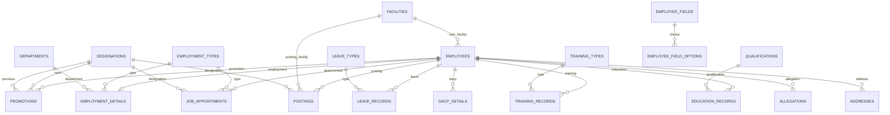

# Database schema

Every application table is in the PostgreSQL schema `hrms`. SQLAlchemy attaches that schema in `app/extensions.py`. SQLite tests translate `hrms` to the default schema. The migration bookkeeping table is `hrms.alembic_version` (`version_num`). It is not an application model, and `hrms_app` is not granted access to it.

Row-level security is enabled on the tables created by revision `0001_initial` and on `facility_code_counters`. When the `hrms_app` role exists at migration time, it receives `SELECT`, `INSERT`, `UPDATE`, and `DELETE` and the policy `hrms_app_all` (`USING (true) WITH CHECK (true)`). `PUBLIC`, `anon`, `authenticated`, and `authenticator` are revoked. The table owner bypasses row-level security.

Foreign keys use `ON DELETE RESTRICT`, except `employee_field_options.field_id`, which cascades when a field definition is removed.

## Entity diagram

`employees.custom_data` points at `employee_fields` by the field id stored inside JSON. That link is not a foreign key. `audit_events` stores `entity_type` and `entity_id` and has no foreign key. `field_catalog`, `employee_code_counters`, `facility_code_counters`, and `login_throttle` stand alone.

## Shared columns

Most business tables use these columns.

| Column | Type | Notes |
| --- | --- | --- |
| `id` | uuid | Primary key, generated in the application. |
| `created_at` | timestamptz | Set on insert. |
| `updated_at` | timestamptz | Set on insert and update. |
| `version` | integer | Starts at 1. Incremented on a successful edit. |

Exceptions are listed with each table.

## Master lists

`departments`, `designations`, `employment_types`, `qualifications`, `training_types`, and `leave_types` share this shape.

| Column | Type | Notes |
| --- | --- | --- |
| `name` | varchar(120) | Required. Unique on `lower(name)`. |
| `is_active` | boolean | Default true. |

`facilities` is separate because it has a code and a place.

| Column | Type | Notes |
| --- | --- | --- |
| `name` | varchar(200) | Required. Not unique. |
| `code` | varchar(32) | Required. Unique. New rows use `FAC-0001`. Older rows may keep a slug. |
| `facility_type` | varchar(80) | Required. |
| `district` | varchar(120) | Required. |
| `block` | varchar(120) | Optional. |
| `is_active` | boolean | Default true. |

## Employees

| Column | Type | Notes |
| --- | --- | --- |
| `employee_code` | varchar(32) | Required. Unique. New rows use `EMP-0001`. |
| `full_name` | varchar(200) | Required. Indexed. |
| `date_of_birth` | date | Optional in the table. Required by the personal form. |
| `gender` | varchar(16) | Optional in the table. Required by the personal form. |
| `phone` | varchar(20) | Optional in the table. Required by the personal form. Stored as text. |
| `email` | varchar(254) | Optional. |
| `facility_id` | uuid | Optional foreign key to `facilities`. Indexed. Restrict on delete. |
| `custom_data` | jsonb | Required. Default `{}`. Keys are employee-field ids. |
| `is_active` | boolean | Default true. Indexed. |

## Addresses

| Column | Type | Notes |
| --- | --- | --- |
| `employee_id` | uuid | Required. Indexed. Restrict. |
| `address_type` | varchar(20) | `present` or `permanent`. |
| `line1` | varchar(250) | Required. |
| `line2` | varchar(250) | Optional. |
| `district` | varchar(120) | Required. |
| `state` | varchar(120) | Required. |
| `pin_code` | varchar(10) | Required. Length 4 to 10 when set. |

Unique on `(employee_id, address_type)`.

## Education, training, and appointments

`education_records`

| Column | Type | Notes |
| --- | --- | --- |
| `employee_id` | uuid | Required. Restrict. |
| `qualification_id` | uuid | Required. Restrict. |
| `specialization` | varchar(200) | Optional. |
| `institution` | varchar(250) | Required. |
| `passing_year` | integer | 1950 through 2100. |

`training_records`

| Column | Type | Notes |
| --- | --- | --- |
| `employee_id` | uuid | Required. Restrict. |
| `training_type_id` | uuid | Optional. Restrict. |
| `title` | varchar(250) | Required. |
| `provider` | varchar(250) | Required. |
| `start_date` | date | Required. |
| `end_date` | date | Required. Must be on or after `start_date`. |
| `remarks` | text | Optional. |

`job_appointments`

| Column | Type | Notes |
| --- | --- | --- |
| `employee_id` | uuid | Required. Restrict. |
| `appointment_reference` | varchar(120) | Required. |
| `appointment_date` | date | Required. |
| `joining_date` | date | Required. On or after `appointment_date`. |
| `designation_id` | uuid | Required. Restrict. |
| `employment_type_id` | uuid | Required. Restrict. |

## Employment and postings

`employment_details` has one row per employee (`employee_id` is unique).

| Column | Type | Notes |
| --- | --- | --- |
| `employee_id` | uuid | Required. Unique. Restrict. |
| `department_id` | uuid | Required. Restrict. |
| `employment_type_id` | uuid | Required. Restrict. |
| `service_joining_date` | date | Required. |
| `retirement_date` | date | Optional. On or after joining when set. |
| `pay_level` | varchar(50) | Required. |

`postings`

| Column | Type | Notes |
| --- | --- | --- |
| `employee_id` | uuid | Required. Restrict. |
| `facility_id` | uuid | Required. Restrict. |
| `designation_id` | uuid | Required. Restrict. |
| `start_date` | date | Required. Indexed. |
| `end_date` | date | Null means this is the current posting. On or after `start_date` when set. |
| `order_reference` | varchar(120) | Required. |
| `remarks` | text | Optional. |

Partial unique index `uq_postings_one_open` on `employee_id` where `end_date` is null.

## Promotions, allegations, leave, and DACP

`promotions`

| Column | Type | Notes |
| --- | --- | --- |
| `employee_id` | uuid | Required. Restrict. |
| `previous_designation_id` | uuid | Required. Restrict. |
| `new_designation_id` | uuid | Required. Restrict. |
| `effective_date` | date | Required. |
| `order_reference` | varchar(120) | Required. |
| `remarks` | text | Optional. |

`allegations`

| Column | Type | Notes |
| --- | --- | --- |
| `employee_id` | uuid | Required. Restrict. |
| `reference_no` | varchar(120) | Required. |
| `description` | text | Required. |
| `recorded_date` | date | Required. |
| `status` | varchar(32) | `open` or `closed`. |
| `resolution_date` | date | Optional. On or after `recorded_date`. |
| `remarks` | text | Optional. |

`leave_records`

| Column | Type | Notes |
| --- | --- | --- |
| `employee_id` | uuid | Required. Restrict. |
| `leave_type_id` | uuid | Required. Restrict. |
| `start_date` | date | Required. |
| `end_date` | date | Required. On or after `start_date`. |
| `status` | varchar(32) | `recorded` or `cancelled`. |
| `remarks` | text | Optional. |

`dacp_details`

| Column | Type | Notes |
| --- | --- | --- |
| `employee_id` | uuid | Required. Restrict. |
| `stage` | varchar(80) | Required. |
| `effective_date` | date | Required. |
| `order_reference` | varchar(120) | Required. |
| `remarks` | text | Optional. |

## Custom fields

`field_catalog` is a single counter for the form version. It has no timestamps.

| Column | Type | Notes |
| --- | --- | --- |
| `id` | integer | Primary key. |
| `version` | integer | Incremented when the field configuration changes. |

`employee_fields`

| Column | Type | Notes |
| --- | --- | --- |
| `field_key` | varchar(40) | Required. Unique. System keys are `full_name`, `facility_id`, and `phone`. Custom keys look like `cf_` plus 32 hex characters. |
| `label` | varchar(120) | Required. |
| `help_text` | varchar(300) | Optional. |
| `placeholder` | varchar(120) | Optional. |
| `field_type` | varchar(32) | `short_text`, `long_text`, `integer`, `decimal`, `date`, `dropdown`, `yes_no`, or `facility`. |
| `required` | boolean | Default false. System fields stay required. |
| `section` | varchar(80) | Default `Personal Details`. |
| `sort_order` | integer | Default 0. |
| `show_in_register` | boolean | Default false. |
| `is_system` | boolean | Default false. |
| `is_archived` | boolean | Default false. |

`employee_field_options` has timestamps and no `version` column.

| Column | Type | Notes |
| --- | --- | --- |
| `field_id` | uuid | Required. Cascade delete. Indexed. |
| `label` | varchar(120) | Required. |
| `sort_order` | integer | Default 0. |
| `is_retired` | boolean | Default false. |

## Audit, codes, and login throttle

`audit_events` has `id` and `created_at` only. It has no `updated_at` and no `version`.

| Column | Type | Notes |
| --- | --- | --- |
| `actor_id` | uuid | The administrator subject. Indexed. Not a foreign key. |
| `entity_type` | varchar(60) | Required. |
| `entity_id` | uuid | Required. |
| `action` | varchar(32) | Required. |
| `changes` | jsonb | Required. |
| `created_at` | timestamptz | Indexed. |

Index `ix_audit_events_entity` on `(entity_type, entity_id)`.

`employee_code_counters` and `facility_code_counters` each have one application row, `id = 1`.

| Column | Type | Notes |
| --- | --- | --- |
| `id` | integer | Primary key. |
| `last_value` | integer | Highest number already reserved. |

`login_throttle`

| Column | Type | Notes |
| --- | --- | --- |
| `id` | integer | Primary key. |
| `bucket` | varchar(200) | Required. Unique. One bucket per IP and one per email. |
| `attempts` | integer | Default 0. |
| `window_started_at` | timestamptz | Start of the 15-minute window. |
| `updated_at` | timestamptz | Required. |

## Values that are not columns

Gender choices used by the forms are Female, Male, and Other, plus a blank Select choice. Allegation status is `open` or `closed`. Leave status is `recorded` or `cancelled`. Address type is `present` or `permanent`.

`custom_data` stores a JSON object. Dropdown values store the option id. Yes/no stores a boolean. Dates and numbers store JSON scalars. Aadhaar is stored as 12 digits when the field label matches that word. The display adds spaces. The database does not check the digit length. That check is in the application.
